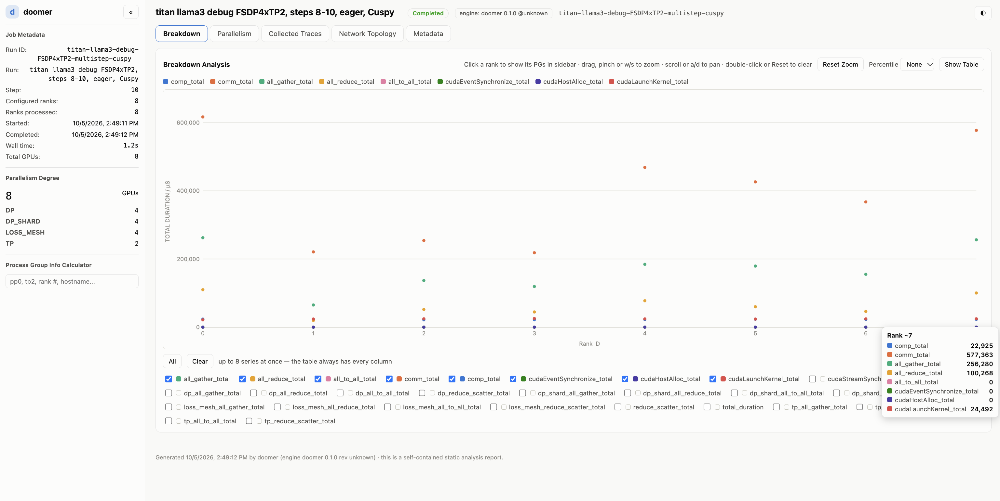
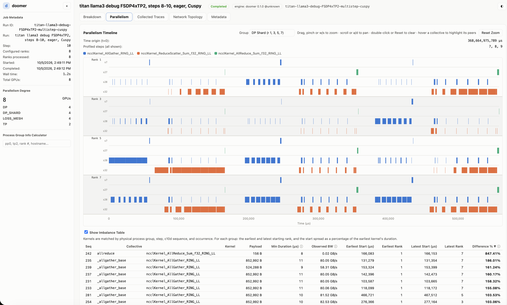

# comms_viz

comms_viz is an analysis tool for visualizing cross-rank timelines for distributed training jobs, and
identifying per-rank inefficiencies like stragglers, lateness, and compute/communication
imbalance. comms_viz reads per-rank PyTorch profiling traces, and aggregates them into a single report that answers:

- which ranks arrive late to which collectives, and how often they do so (persistent stragglers)
- which ranks and collective types consume the most time
- how each rank's time splits between compute, collectives and CPU

The **Breakdown** tab plots each rank's total time per collective
type and process group:



The **Parallelism** tab shows one process group at a time (e.g. one TP or
FSDP group), with each rank's comm kernels side by side on a shared timeline,
alongside per-rank utilization and, when the traces carry GPU counters (SM
activity, DRAM and NVLink bandwidth), a per-rank track of each counter over
time.

It also shows a per-collective breakdown of rank arrival time skew and imbalance, and a per-rank breakdown
of time spent in compute, collectives, and active GPU / CPU time:



## Usage

```sh
./target/release/comms_viz --trace-root ./traces/step_10 --out ./analysis
python3 -m http.server --directory ./analysis/report 8000
```

comms_viz expects you to gather every rank's trace for a profiling step into a single directory first. The command analyzes the traces into
`./analysis/tree/<run-id>/`, writes the report page and its `.pgdata` data
files to `./analysis/report/` and the structured report to
`./analysis/structured_report/`, for rendering as local HTML page.

| Flag | Description |
| --- | --- |
| `--trace-root DIR` | One step's traces, one file per rank, all in this directory. File names: see `--trace-format`. Omit the flag to rebuild the reports from an existing `--out` without re-analyzing. |
| `--out DIR` | Where analysis results and, by default, both reports are written. Required. |
| `--report DIR` | Where the HTML report is written. Default `<out>/report`. |
| `--structured-report DIR` | Where the analysis is written as a summary for scripts or LLM agents (`README.md` and `summary.json`), whose size does not grow with world size. Default `<out>/structured_report`. |
| `--run-id ID` | Name of the run's subdirectory under `<out>/tree/`, also used in the report file names. Default `local-run`, or `local-run-2`, `-3`, ... if taken. An explicit id that is taken is an error. |
| `--overwrite` | Replace an existing run with the same id. |
| `--run-name NAME` | Run name shown in the report. |
| `--trace-format auto\|json\|pftrace` | `json` reads `*.json` and `*.json.gz` with any name; the rank comes from the trace. `pftrace` reads `*.pftrace` and `*.pftrace.gz`; the rank comes from the file name (see [Input](#input)). `auto` (default) picks whichever is present; pass the format if the directory has both. |
| `-v`, `--verbose` | Print per-rank analysis time. |

## Installation

Install rustup, then run:

```sh
cargo build --release --locked
```

### PyTorch requirements

- PyTorch's Kineto backend works best with PyTorch 2.6 or later, for DeviceMesh axis names
  to be properly emitted.
- `.pftrace` traces come from PyTorch's Cuspy profiler backend, currently only in nightlies,
  but likely to be released in PyTorch 2.15.

## CUDA graphs

Collectives replayed from a CUDA graph carry process-group metadata only if
the graph is captured with `torch.cuda.graph(..., enable_annotations=True)`.
For Kineto backend, ensure your framework exports the trace with
`export_chrome_trace(path, cuda_graph_annotations=get_kernel_annotations())`.

Frameworks like TorchTitan already do both steps, but without them, collective
kernels aren't properly recognized and attributed to PGs by comms_viz. When
NCCL kernels lack process-group metadata, comms_viz warns and names the
affected ranks.

## Collectives across ranks

Collectives are matched across ranks by the c10d metadata (process group,
collective, sequence number) that PyTorch's profiler attaches to their GPU
events, and the several events of one call, e.g. a copy-engine collective's
copies, are grouped into a single call. Calls without a sequence number and
p2p send/recv (whose sequence is always 0) are not matched: only their order
would pair them, so they appear on the timeline but in no cross-rank
statistic. Observed bandwidth is the full payload
(nccl-tests' algbw) over the shortest call duration across ranks, since every
rank's duration includes waiting for the others.

## Custom collectives

PyTorch attaches process-group metadata only to c10d collectives. comms_viz also recognizes a few other
collective libraries by kernel name (e.g. HybridEP, DeepEP, symmetric-memory
barriers) and counts their kernels in each rank's communication time, but shows
them on no group timeline: without a process group or sequence number, nothing in
the trace says which group a kernel belongs to or which calls on other ranks it
pairs with. Communication fused into compute kernels (e.g. Dist-MoE's grouped
GEMMs) counts as compute. comms_viz doesn't currently provide a clean API to extend
to recognizing custom collective kernels, but we are currently working on this.

## Limitations

- **Communication without c10d metadata.** comms_viz attributes a kernel to a process
  group, and matches it across ranks, only through the metadata PyTorch's c10d attaches.
  NCCL kernels without it count as communication time but appear on no group timeline and
  in no cross-rank statistic; comms_viz warns with the affected ranks and their share of
  NCCL time. Known sources:
  - p2p batched with `batch_isend_irecv` (e.g. Megatron pipeline and Transformer Engine
    context-parallel send/recv): the CPU-side ops are annotated, the batch's kernel isn't;
  - NCCL called directly rather than through c10d (e.g. DeepSpeed DeepCompile, vLLM's
    PyNccl);
  - CUDA-graph replays whose capture annotations are missing (see CUDA graphs).
- **Kernels comms_viz doesn't know.** Collective kernels outside NCCL that are not in
  comms_viz's short list of known libraries (see Custom collectives), e.g. Transformer
  Engine userbuffers or vLLM custom all-reduce, count as compute.
- **Sequence numbers.** Cross-rank matching needs the c10d sequence number on each
  collective kernel: PyTorch before 2.12 doesn't record it, and some collectives (e.g.
  symm_mem ops) never have one. p2p is never matched (see Collectives across ranks).
- **Axes.** Groups are pooled into axes (`tp`, `dp_shard`, ...) by their description:
  DeviceMesh names them (`mesh_tp` -> `tp`), as do frameworks with their own names
  (Megatron's `TENSOR_MODEL_PARALLEL_GROUP`). A group created without a description
  (`new_group`'s default `undefined`, e.g. DeepSpeed, picotron) is its own axis, named by
  its process-group name, so per-axis statistics don't pool it with anything. Group
  membership comes from the trace either way.
- **Partial captures.** Any subset of ranks can be analyzed; cross-rank statistics cover
  only collectives whose whole group is present, and the report says how many ranks it
  covers. All ranks should capture the same profiler step; comms_viz warns when they don't.

## Provenance

comms_viz is an entirely AI-written codebase, with human direction over its
features, metrics and visualizations, and human use on real large-scale
training analysis. Most of the code has had little or no line-by-line human
review.

Contributions and fixes are welcome, to be judged mainly on functionality.
